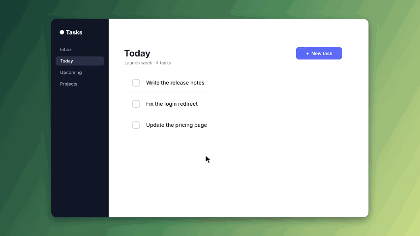
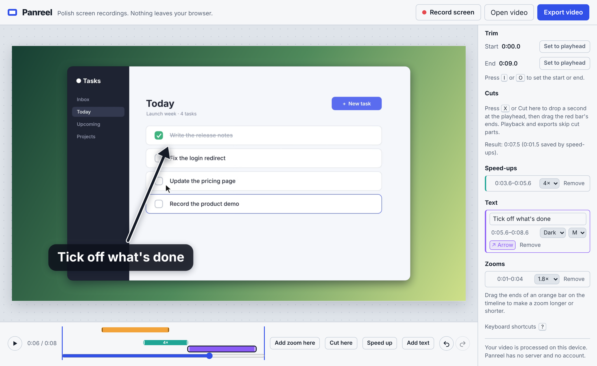

# Panreel

**Turn raw screen recordings into polished demo videos — free, open source, and entirely in your browser.**

**[▶ Try it in your browser](https://konokai68-wq.github.io/panreel/)** — nothing to install, nothing uploaded.

Panreel is a lightweight, browser-only alternative to paid screen-recording studios such as Screen Studio. Record your screen (or drop in an existing clip), put it on a clean backdrop with rounded corners and a soft shadow, add smooth zooms to the moments that matter, and export. No install, no account, no upload: your video never leaves your device.



*This GIF was made with Panreel itself — a zoom, a speed-up and a text callout with an arrow, exported as a GIF.*



## What it does today

- **Try it in one click**: no recording at hand? Press *Try a sample clip* on the start screen — Panreel draws a short made-up app screencast right in your browser, then press *Auto zoom* to see what it does
- **Record** your screen, a window or a tab straight from the browser — or open / drag-and-drop a WebM or MP4 file
- **Style** the frame: six gradient backdrops, any solid colour, or your own image (with optional blur), plus padding, corner radius, shadow and an optional plain window title bar (light or dark)
- **Canvas sizes** for every platform: 16:9, 1:1, 9:16 and 4:3
- **Look presets**: press *Save this look* to keep the backdrop, canvas size, padding, corners, shadow and window bar; next time, one click on the saved look styles a new clip the same way (up to 8 looks, kept in this browser; image backdrops are not stored)
- **Smooth zooms**: press *Add zoom here*, click the preview to aim it, choose 1.4×–3×. Zooms ease in and out automatically, with optional motion blur while the camera moves (on by default, *Motion blur on zooms* under *Frame*)
- **Trim** the start and end — set them to the playhead with a button or the <kbd>I</kbd> / <kbd>O</kbd> keys
- **Auto zoom**: one click scans the clip for moments where only part of the screen changes (a menu opens, text is typed) and adds zooms aimed at them — no cursor tracking or extension needed. Tweak or undo them like any other zoom
- **Resize zooms** by dragging the ends of their bars on the timeline
- **Cut out** the boring parts: press *Cut here* (or <kbd>X</kbd>) and drag the red bar's ends to choose what to remove. Playback skips cuts and every export leaves them out, with the sound kept in sync
- **Speed up** slow stretches (installs, loading, typing): press *Speed up* (or <kbd>S</kbd>), pick 2×, 4× or 8× and drag the teal bar's ends. Sped-up parts play fast and silent in the preview and in every export
- **Text callouts**: press *Add text* (or <kbd>T</kbd>), type a caption, pick Dark / Light / Blue and S / M / L, drag it anywhere on the preview, and drag the violet bar's ends to set when it shows. Callouts fade in and out and are drawn into every export
- **Arrows**: press *Arrow* on a callout (or <kbd>A</kbd>) to point at something, then drag the arrow's tip on the preview. Clear the text for a bare arrow
- **Blur sensitive details**: press *Add blur box*, drag it over an email, name or API key on the preview and drag its corner to resize. Pick *Pixelate* or *Solid* — or *Spotlight* to dim everything around the box and point viewers at it — and *Whole clip* or *Part of the clip* (set *From* / *To* at the playhead); the box stays on the same spot of the screen through zooms and covers it in every export
- **Export** to MP4 (H.264) or WebM with WebCodecs: every frame is decoded, styled and re-encoded directly, so the result is frame-accurate and you don't have to watch it play. MP4 is used when your browser can encode H.264 (and AAC for the soundtrack); otherwise Panreel picks WebM so the audio is never dropped. Browsers without WebCodecs fall back to real-time WebM recording
- **GIF export** for short clips (up to 30 s): 480p, 15 fps, loops forever — ready to drop into a README, pull request or chat
- **Export settings**: pick 720p, 1080p, 1440p or 4K and 30 or 60 fps (30 fps exports about twice as fast). Your choice is remembered in this browser, and long exports show how much time is left
- **Webcam bubble**: tick *Record my camera with the screen* to record your face alongside, or add an existing camera clip to any video. Choose a circle or rounded square, size, corner (or drag it on the preview) and mirroring — it's kept separate until export, so you can restyle it any time
- **Never lose an edit**: the project (videos, camera clip, backdrop image and every edit) is saved in this browser as you work. Reload or come back later and press *Resume last project* — or *Discard* to start clean. It stays on your device
- **English or Japanese** (日本語): picked from your browser language; switch with the button in the top bar or open the app with `?lang=ja`. The whole interface is translated, including messages, the shortcut sheet and the edit lists
- **Undo / redo** for zooms, cuts, speed-ups, text, blur boxes, trim and frame settings (<kbd>Ctrl/⌘ Z</kbd>, <kbd>Ctrl/⌘ Shift Z</kbd>)

## Keyboard shortcuts

| Key | Action |
| --- | --- |
| <kbd>Space</kbd> | Play / pause |
| <kbd>←</kbd> <kbd>→</kbd> | Step 0.1 s (hold <kbd>Shift</kbd> for 1 s) |
| <kbd>Home</kbd> <kbd>End</kbd> | Jump to the clip start / end |
| <kbd>I</kbd> <kbd>O</kbd> | Set the clip start / end to the playhead |
| <kbd>Z</kbd> | Add a zoom at the playhead |
| <kbd>X</kbd> | Cut 1 s at the playhead |
| <kbd>S</kbd> | Speed up 2 s at the playhead |
| <kbd>T</kbd> | Add text at the playhead |
| <kbd>A</kbd> | Arrow on / off for the text at the playhead (adds text if there is none) |
| <kbd>Delete</kbd> | Remove the cut, speed-up, text or zoom at the playhead |
| <kbd>Ctrl/⌘ Z</kbd> · <kbd>Ctrl/⌘ Shift Z</kbd> | Undo · Redo |
| <kbd>?</kbd> | Show all shortcuts |

## Use it

The hosted version is at **https://konokai68-wq.github.io/panreel/**. To run it locally:

```bash
npm install
npm run dev
```

Then open the printed URL in Chrome, Edge or Firefox on a desktop computer, and press *Try a sample clip* for a quick tour.

| Command | What it does |
| --- | --- |
| `npm run dev` | Start the dev server |
| `npm test` | Run unit tests (Vitest) |
| `npm run build` | Type-check and build the static site into `dist/` |
| `node scripts/make-demo.mjs` | Rebuild `docs/demo.gif` and `docs/screenshot.png` with the built app (needs Playwright + Chromium; run `npm run build` first) |
| `node scripts/make-social.mjs` | Rebuild `public/social-preview.png`, the 1280×640 link-preview card, from the screenshot (needs Playwright + Chromium) |

## Roadmap

See [docs/ROADMAP.md](docs/ROADMAP.md). Next up: a cursor highlight and a faster export in a worker.

Shared links to the hosted site show a preview card (`public/social-preview.png`). The Open Graph / Twitter tags are added at build time; in GitHub Actions the image URL is worked out from the repository name, so the card keeps working after a rename.

## Credits

Encoding and muxing use [Mediabunny](https://github.com/Vanilagy/mediabunny) (MPL-2.0); GIFs are written with [gifenc](https://github.com/mattdesl/gifenc) (MIT).

## Privacy

Panreel is a static site. There is no backend, no analytics and no account. Recording, editing and encoding all happen locally with standard browser APIs; the autosaved project lives in your browser's IndexedDB.

## License

[MIT](LICENSE)
